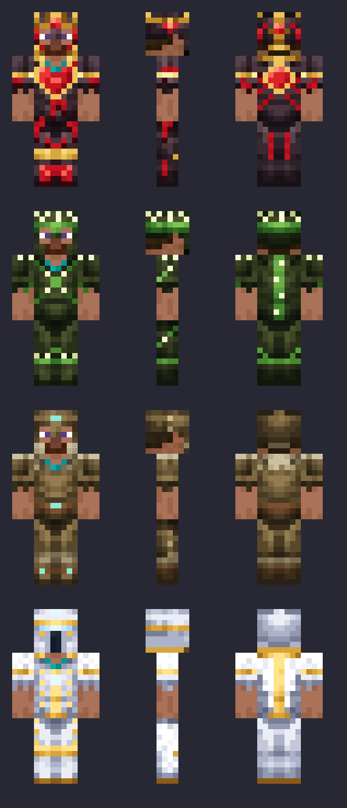

<p align="center">
  
</p>

<p align="center">
  <b>Legendary one-of-a-kind weapons, relics and forge rituals for Paper servers.</b><br>
  Every weapon has its own abilities, exists only <b>once</b> on the whole server and has to be earned:
  hunt bosses for legendary materials, then forge it in a 15-minute ritual the whole server can see.
</p>

<p align="center"><b>📖 <a href="https://freonik.github.io/Forgebound/">Wiki – every weapon, relic, material and event (CZ / EN)</a></b></p>

<p align="center">
  
  
  
</p>

---

## Table of contents

- [Features](#features)
- [Installation](#installation)
- [How it works](#how-it-works)
- [Weapons](#weapons)
- [Relics](#relics)
- [Legendary materials](#legendary-materials)
- [Legends](#legends)
- [Enchantments](#enchantments)
- [Bounties](#bounties)
- [PvP](#pvp)
- [Token shop](#token-shop)
- [Events](#events)
- [Big events and mythic weapons](#big-events-and-mythic-weapons)
- [Quests](#quests)
- [Totem of the Forge](#totem-of-the-forge)
- [Meteors](#meteors)
- [Scorched Lands](#scorched-lands)
- [The Forge Warden](#the-forge-warden)
- [Advancements](#advancements)
- [HUD, Codex and leaderboards](#hud-codex-and-leaderboards)
- [Teams](#teams)
- [Moderation and watchdog](#moderation-and-watchdog)
- [Commands and permissions](#commands-and-permissions)
- [Configuration](#configuration)
- [Resource pack](#resource-pack)
- [License](#license)

---

## Features

- **14 legendary weapons and tools** (swords, axes, a bow, a crossbow, a rifle, a spear, a trident, a pickaxe...) with original abilities on **F** and **Shift + F**, plus on-hit effects and passives
- **18 relics** for every slot, including four **4-piece armor sets** (Heartsteel, Thorn, Thick Hide, Pale Seraph): helmet, chestplate, leggings, boots and off-hand (stasis, revive, thorns,
  a growing heart, grey health, soul focus, a parrying shield)
- **Tank builds**: some abilities scale with your **max HP**, so they get stronger with Heartsteel Core
- **21 legendary materials** that drop from bosses and rare mobs or hide in structure chests, **45 % max chance**
- **Forge rituals**: forging takes 15 minutes on a crafting table and the location is revealed step by step
- **One of each**: every weapon and relic can exist only once per server
- **Two new enchantments**: Forge Touch (auto-smelting) and Bounty Hunter I–III, straight from the enchanting table
- **Living legends**: `/legends` shows every legend and your own stats with it; abandoned legends return to the forge
- **Kill effects**: every legendary weapon has its own finisher
- **Bounties**: carrying a legend puts a price on your head, paid out in **Bounty Tokens**
- **Token shop**: spend Bounty Tokens in `/shop` on diamonds, netherite, golden apples... with a weekly rotating offer
- **Legend Tracker**: a compass that leads you to the nearest legend holder
- **Events**: Blood Moon, Rifts, Legend Hunts, Happy Hour, Forge Market and Golden Shipments keep the server alive
- **Scorched Lands**: a rare burnt biome with ruined forges, workshops, slag heaps and watchtowers to loot
- **Meteors**: every few hours a meteor crashes somewhere with a cache of legendary loot
- **The Forge Warden**: a three-phase boss you wake at a crafting table
- **Forge menu** opened from any crafting table, with its own look when the resource pack is used
- **Advancements**: a Forgebound tab in the advancements screen, with toasts, chat messages and rewards
- **Resource pack** with animated textures, custom worn armor, particles and a themed menu
- **HUD**: a sidebar, tab list and join title with your tokens, bounty and the current event (works with the TAB plugin)
- **Forge Codex**: a book for new players that explains everything (`/codex`)
- **Leaderboards**: `/top`, plus placeholders for top-10 holograms (PlaceholderAPI)
- **Live MOTD**: the server list shows what's happening right now (a Rift, the Blood Moon, a ritual...)
- **Dialog windows**: confirmations for bigger purchases and payments, a `/pay` form and an admin panel for the season start
- **Smart commands**: the chat suggests players, items, events and categories while you type
- **Fully configurable**: numbers, cooldowns, drop chances, ritual length, messages, on/off switches

<p align="center"></p>

---

## Installation

1. Download `Forgebound.jar` from the [**latest release**](../../releases/latest) (or build it yourself, see below).
2. Put it into your server's `plugins/` folder and start the server (Paper **1.21.11**, Java **21**).
   Forgebound is a *Paper plugin*: it doesn't run on Spigot, and it can't be loaded with `/reload` or PlugMan (restart instead).
3. *(Optional, recommended)* Add the resource pack to `server.properties`. The release notes contain the exact two lines
   to copy (link + SHA1), see [Resource pack](#resource-pack). Then set `menu.resource-pack: true` in
   `plugins/Forgebound/config.yml`.
4. Run `/forge reload` after any config change. No restart needed.

> **Auto-update:** every hour Forgebound checks GitHub for a newer release, downloads it into `plugins/update/`
> and tells the admins; the new version starts with the next **restart**. It also puts that release's resource pack
> link and SHA1 into `server.properties`, so you never have to copy the SHA1 by hand (only if your pack line already
> points to this repository). Turn it off with **`/forge update off`** (`/forge update now` checks right away).
>
> **Nightly restart** (off by default, `auto-update.restart.enabled`)**:** at 4:00 Forgebound, Forgebound Guard and Forgebound Teams check for
> a new version together. If any of them has one, players get a 10-minute countdown and the server restarts once for
> all of them (it waits for a running big event). Turn it on only if your host starts the server again after it stops.
> `/forge update restart` checks and restarts now, `/forge update cancel` stops the countdown.
>
> **Updating by hand:** just replace the jar. New weapons, relics, materials and messages are added to your existing `config.yml`
> automatically (your own changes stay). Entries you delete on purpose are remembered and not added back.
> Your forged items and running rituals are kept in `data.yml`.


> **Coming from CustomCraft?** Forgebound is the same plugin with a new name. Remove `CustomCraft.jar`, add
> `Forgebound.jar` and restart: your `plugins/CustomCraft/` folder is copied to `plugins/Forgebound/`
> automatically, and all existing legends, tokens and advancements keep working. Change the permissions
> (`customcraft.*` → `forgebound.*`), the placeholders (`%customcraft_…%` → `%forgebound_…%`) and the
> resource pack link (`Forgebound-pack.zip`).

---

## How it works

```
 kill bosses / loot structures  →  legendary material  →  forge at a crafting table
                                                              │
                                     15 min ritual, location revealed step by step
                                                              │
                                              weapon drops on the table (only one exists)
```

### The forge
Shift + right-click any **crafting table** with an empty hand. Pick a recipe and the materials show *needed / you have*.
Press **FORGE** when you have everything.

<p align="center"></p>

### Forge ritual
- The materials are taken and the whole server is told **which item** is being forged, but **not by whom** ("Someone").
- A boss bar shows the item, the time left and a location hint. The location is **revealed step by step**:

  | Ritual progress | Location shown |
  |---|---|
  | start | only the dimension ("somewhere in the Overworld") |
  | 33 % | an area of ±500 blocks (randomly shifted, the centre is not the table) |
  | 66 % | an area of ±100 blocks |
  | 87 % | exact coordinates |

- The item floats and spins above the table. The table can't be broken, burned, blown up or moved while the ritual runs.
- When the time is up, lightning strikes and the item **drops on the table**. Whoever picks it up owns it, so defend it.
- The timer only runs while the server is online and survives restarts.
- A ritual needs at least **3 players online** to start, so nobody forges a legend alone at 3 am.
  If players leave and fewer than 3 are online, the timer **pauses** until they're back.
  Change it with `ritual.min-players` (0 = no limit) and `ritual.pause-below-min-players`.

### One of each
Every weapon and relic can exist **only once**. As soon as its ritual starts, nobody else can forge it.
If the item is destroyed as a dropped item (lava, fire, void, despawn), it can be forged again.

### ★ Stars and the Ancient Forge
Every legend weapon has **1 to 5 stars** (in half steps). Stars change *all* the weapon's damage (hits, arrows,
abilities) and its ability cooldowns:

| Stars | Damage | Cooldowns |
|---|---|---|
| ★☆☆☆☆ (freshly forged) | −15 % | +15 % |
| ★★★☆☆ | as before stars | as before |
| ★★★★★ | +15 % | −15 % |

- Stars are earned **only at an Ancient Forge**, and there are three, each stronger than the last:

  | Forge | Where | Up to |
  |---|---|---|
  | Scorched Lands | deep in one of the Scorched Lands areas | ★★ |
  | Nether | somewhere in the Nether | ★★★ |
  | End | rises out of the void on a floating island **when the dragon dies** | ★★★★★ |

  Each one is a landmark: a round stepped platform, a domed hall on eight pillars and four towers with signal fires. A pillar of soul fire rises above it, so you can spot it from far away. Use its anvil while holding the
  weapon: one ritual = one star up, and every star costs more (the last ones need the weapon's own legendary material
  and a Nether Star). The weapon **stays in the forge** until the ritual ends and then drops there, so whoever is
  standing there can take it. Afterwards the forge cools down for a day.
- **Dying costs stars.** Killed by a player: **−2 stars** on every legend weapon you carry. Any other death: −½ star.
  A weapon never drops below ★.
- Weapons forged before stars existed start at ★★★.

---

## Weapons

All abilities use **F** (swap hands) and **Shift + F**. Cooldowns show in the action bar while you hold the weapon.
On-hit effects need a **charged** hit (no spam-clicking).

###  Echo Blade (sword)
| | |
|---|---|
| On hit | **Echo**: 1.5 s later the hit repeats for 40 % of its damage |
| F | **Rewind** (30 s): snap back to where you stood 4 s ago and regain the health you had then |
| Shift + F | **Resonance** (40 s): everyone you hurt in the last 10 s takes 50 % of that damage again (max 14) |

###  Graviton Hammer (axe)
| | |
|---|---|
| Passive | Resistance I while held |
| On hit | **Crushing Weight**: fall onto the target for +1 damage per block fallen (max +20), and a mid-air hit cancels your fall damage like a mace. Standing above it gives +1.5 per block (max +8). Airborne targets get slammed down |
| F | **Gravity Anchor** (35 s): a 7-block field for 6 s; enemies inside are slowed and yanked back if they try to leave |
| Shift + F | **Upheaval** (45 s): lift every enemy around you and slam them down; the higher they fall, the more damage |

###  Hexbow (bow)
| | |
|---|---|
| Passive | Speed I while held, witch-particle arrow trail |
| On hit | **Ricochet** (40 %): the hex jumps to the nearest other enemy for 60 % damage |
| F | **Mirror Shot** (22 s): your next arrow swaps your place with whatever it hits |
| Shift + F | **Hex Mark** (35 s): the target you look at glows and takes +30 % damage from everything for 10 s |

###  Soulbinder (scythe)
| | |
|---|---|
| On hit | Collect a soul per hit, 2 per kill (max 5); heal 15 % of damage dealt |
| F | **Soul Link** (40 s): for 6 s, 50 % of the damage you take is redirected to the linked target |
| Shift + F | **Harvest** (15 s): spend all souls to heal, gain absorption and launch homing soul wisps |

###  Hydra Edge (sword)
| | |
|---|---|
| On hit | **Cleave**: 40 % damage to everyone within 3 blocks of the target, heals 10 % of it |
| F | **Crescent** (12 s): spin attack, 8 damage around you, +1 heart per enemy hit |
| Shift + F | **Hydra's Wrath** (45 s): 6 s of Haste II, Strength I and Speed I; Cleave hits twice as hard |

###  Butcher's Cleaver (axe)
| | |
|---|---|
| Passive | below 30 % HP you regenerate 1.5 % of your max HP per second |
| On hit | **Blunt Force**: +0.6 damage for every heart *you* are missing (max +6) |
| F | **Cleaver Toss** (8 s, costs 1 heart): the cleaver flies 18 blocks and hits for 4 + 15 % of the target's *current* health (max 16) with Slowness II. A hit heals you 5 % of your max HP and refunds half the cooldown |
| Shift + F | **Bloodrush** (70 s): pay 10 % of your current health, then regenerate **40 % of your max HP** over 10 s with Speed II; debuffs don't stick |

###  Abyssal Maw (sword)
| | |
|---|---|
| On hit | **Taste**: charged hits (and the tongue) stack Taste on the target, max 3, for 6 s |
| F | **Tongue Lash** (10 s): a tongue grabs the first enemy, deals 3 + 4 % of your max HP, slows it and **yanks it to you**. Reach is 8 blocks **+0.25 per HP above 20** (max 20), so it grows with Heartsteel |
| Shift + F | **Devour** (45 s): swallow what you look at. **A player ally**: hidden and untouchable inside you for 4 s (they can sneak out). **An enemy with 3 Taste**: trapped and blinded for 2 s, then spat out far for 6 + 5 % of your max HP |

###  Clawline Pick (pickaxe)
| | |
|---|---|
| Passive | Haste II while held; mined ores have a 20 % chance to drop twice (Efficiency V, Fortune III) |
| F | **Clawline** (6 s): shoot a hook at the block you look at (24 blocks) and get yanked to it, no fall damage after |
| Shift + F | **Dive** (30 s): hop up and slam down, carving a 3×3 shaft up to 8 blocks deep; landing sends a shockwave (6 damage, 4 blocks). Claims / protected regions are respected, containers are never broken |

###  Silk Needle (sword)
| | |
|---|---|
| Passive | Speed I while held, very fast attacks |
| On hit | **Silk Bind**: every 3rd charged hit wraps the target in silk (Slowness IV for 1.25 s) |
| F | **Silk Dart** (8 s): throw the needle on a thread (16 blocks); it stabs the first enemy for 4 and pulls you to it, or to the block it hits |
| Shift + F | **Thread Storm** (40 s): spin in a storm of silk for 3 s, 1.5 damage to everyone within 3.5 blocks every ¼ s; you float while in the air |

###  Rimebreaker (war axe)
| | |
|---|---|
| F | **Throw / Recall** (3 s): throw the axe (30 blocks): 7 damage and a freeze. It stays stuck in the block or enemy; press **F** again to call it back, hitting and freezing everything on its way. While it's out you fight with your fists |
| Shift + F | **Frost Runic** (35 s): a wave of ice rolls 12 blocks forward, 6 damage, freezes and slows; water it crosses freezes over |

###  Pinning Repeater (crossbow)
| | |
|---|---|
| Passive | Quick Charge III, Piercing II |
| F | **Pin Bolt** (20 s): your next bolt pins whatever it hits for 2 s (no walking, no jumping), a chain shows where |
| Shift + F | **Volley** (25 s): 5 bolts at once in a fan, no reload needed |

###  The Last Act (rifle)
| | |
|---|---|
| Passive | Quick Charge II; every **4th** bolt is critical (double damage) |
| F | **Spotlight** (14 s): a long golden shot at the first enemy in line; if you hit them in the last 4 s, they're rooted for 1.5 s |
| Shift + F | **Finale** (75 s): plant your feet and take aim - **4 shots** inside a 60° cone (right-click or F), more damage the lower the target's health, the 4th is critical; hits slow |

###  Valkyrie's Lance (spear)
| | |
|---|---|
| Passive | +1 block reach |
| F | **Lunge** (10 s): dash forward, piercing everyone in the way for 7 damage |
| Shift + F | **Javelin** (30 s): throw the lance; it homes in on the target you look at (10 damage + glowing) and flies back |

###  Trident of the Great Sea (trident)
*In memory of the King of the Great Sea.*

| | |
|---|---|
| On hit | **Tide**: +40 % damage and Slowness II on hits in water or rain (throws too) |
| F | **Tidal Surge** (3 charges, then 20 s): riptide anywhere, no water or rain needed; spinning hits deal 8 |
| Shift + F | **The Great Sea** (60 s): a tidal wave rolls out (8 blocks, 6 damage, pushback), then for 8 s Surge has no cooldown and you get Speed II, Dolphin's Grace and Conduit Power |

Loyalty III and Impaling V.

> **Max HP scaling.** Cleaver Toss, Bloodrush, Tongue Lash and Devour use your *max* health, so Heartsteel Core
> (up to +10 hearts) and Health Boost make them stronger. Example for Tongue Lash: 20 HP → 8 blocks,
> 40 HP (full Heartsteel) → 13 blocks.

---

## Relics

<p align="center"></p>

Relics only work in their own slot. You can wear one relic per slot: **helmet**, **chestplate**, **leggings**, **boots**
and **off-hand**.

| | Relic | Slot | Effect |
|---|---|---|---|
|  | **Stasis Hourglass** | off-hand | Right-click: golden statue for 2.5 s. Nothing can hurt you, but you can't move or attack (120 s cooldown) |
|  | **Stitchguard** | off-hand (shield) | **Parry**: raise the shield right before a hit (0.35 s window) and the hit is cancelled, then you stitch through to the attacker's back for 8 damage. **Shell**: while blocking, 3 hits from *any* side are absorbed (regrows 20 s after it cracks) |

### Armor sets

**Heartsteel**, **Thorn**, **Thick Hide** and **Pale Seraph** are full sets: a helmet, a chestplate, leggings and boots that look alike. Every piece is
its own legend (forged with its own ritual, one of each per server). **Each piece gives 1/4 of the set's effect;
all four together give 5/4.** You can mix pieces of different sets, but the full set is clearly the strongest.

| Set | Pieces | Effect (full numbers, before the 1/4 or 5/4) |
|---|---|---|
| **Heartsteel** |  Helm ·  Core ·  Greaves ·  Treads | A charged hit on a **player** deals 3 + 5 % of your max HP extra and **permanently** grows your max HP (up to +10 hearts; every piece stores its share). Once per player every 30 s. Mobs don't count |
| **Thorn** |  Crown ·  Plate ·  Greaves ·  Treads | Reflects 2 + 25 % of melee damage (half vs. arrows); attackers get **Grievous Wounds** (no healing for 3 s) |
| **Thick Hide** |  Cowl ·  Mantle ·  Thick Hide ·  Stompers | 40 % of the damage you take becomes **grey health** that is lost over ~3 s (up to 50 % of your max HP). **Double-tap Shift** to shrug the grey health off so you never lose it (20 s cooldown) |
| **Pale Seraph** |  Soul Vessel Mask ·  Mantle ·  Greaves ·  Angel's Wings | **Two effects**, every piece adds to both. **Soul**: charged hits fill your Soul (11 per hit, max 99); hold **Shift** and stand still for 1.5 s to turn 33 Soul into 3 hearts (getting hit breaks it, Soul is lost on death). **Wings**: when you would die, you come back with 50 % HP and 3 s of protection, and take 50 % less fall damage. The revive cooldown is 600 s divided by the set share (1 piece = 40 min, the full set = 8 min) |

The action bar shows how many pieces you wear (`2/4`, `4/4 ✦`). A Heartsteel Core forged before the sets keeps a quarter
of the max HP it had grown, like every other piece. Thick Hide, the Soul Vessel Mask and Angel's Wings became one piece
of their sets too.

- Cooldowns and Heartsteel stacks are stored on the item itself.
- The armor relics have their own look when worn and small particle effects
  (feather wings at the ankles, a heartbeat on the chest, thorn bursts).
- Relics and weapons can't be used in a smithing table (no trims, no netherite upgrade).

<p align="center"></p>

---

## Legendary materials

Every weapon and relic needs one legendary material. **Nothing is guaranteed**: the best chance is 45 %.

| | Material | Where to find it | Used for |
|---|---|---|---|
|  | **Resonant Shard** | Warden 35 % · Ancient City chests 3 % | Echo Blade |
|  | **Graviton Core** | Breeze 3 % · Ominous trial vaults 8 % | Graviton Hammer |
|  | **Hexed Thread** | Evoker 8 % · Witch 2 % | Hexbow |
|  | **Soul Ember** | Wither 40 % · Wither Skeleton in Soul Sand Valley 2 % | Soulbinder |
|  | **Hydra Scale** | Elder Guardian 30 % | Hydra Edge |
|  | **Chrono Sand** | Desert Pyramid chests 6 % · Ancient City chests 2 % | Stasis Hourglass |
|  | **Seraph Feather** | Ender Dragon 45 % · Phantom above Y 200, 2 % | Angel's Wings |
|  | **Thornheart Seed** | Jungle Temple chests 8 % · Ravager 4 % | Thorn Plate |
|  | **Crimson Heart** | Wither 25 % · Piglin Brute 3 % | Heartsteel Core |
|  | **Ravenous Marrow** | Zoglin 6 % · Hoglin 2 % · Bastion hoglin stable chests 6 % | Butcher's Cleaver |
|  | **Abyssal Lure** | Drowned 1 % · big Underwater Ruin chests 5 % · Shipwreck treasure 4 % | Abyssal Maw |
|  | **Behemoth Hide** | Warden 20 % · Woodland Mansion chests 6 % | Thick Hide |
|  | **Pale Fragment** | Stronghold library chests 8 % · Stronghold corridor chests 3 % · Enderman 0.5 % | Soul Vessel Mask |
|  | **Carapace Shard** | Shulker 3 % · End City chests 5 % | Stitchguard |
|  | **Deepsteel Claw** | Dungeon chests 6 % · Trial Chamber corridor chests 3 % | Clawline Pick |
|  | **Weaver's Silk** | Cave Spider 2 % · Spider 1 % · Mineshaft chests 4 % | Silk Needle |
|  | **Rime Core** | Stray 2 % · Igloo chests 12 % | Rimebreaker |
|  | **Hunter's Bolt** | Pillager 2 % · Pillager Outpost chests 6 % | Pinning Repeater |
|  | **Gilded Mask Shard** | Evoker 3 % · Woodland Mansion chests 8 % | The Last Act |
|  | **Valkyrie Plume** | Vex 2 % · Village weaponsmith chests 4 % | Valkyrie's Lance |
|  | **Sea King's Doubloon** | Buried treasure 8 % · Guardian 1 % | Trident of the Great Sea |

- Mob drops only count when a **player** kills the mob (no farms). Looting helps a little, but the 45 % cap stays.
- The material drops on the ground, glowing, and can't burn, blow up or despawn.
  The **Ender Dragon**'s drop rises out of the dragon and spirals down onto the egg pillar.
- Every find is announced to the server.
- Materials can't be placed, eaten, traded, brewed, smelted or used in vanilla crafting.

---

## Legends

### /legends
Opens an overview of every weapon and relic on the server:

- ✅ **can be forged**, ⚒ **being forged** (time left), or 🔒 **owned by Someone**
- your **own stats** with each legend you've ever used: player kills, mob kills, damage dealt,
  abilities used (F / Shift + F) and time in hand (time worn for relics). Nobody else sees your stats.
- your totals across all legends on your head at the bottom

### Abandoned legends
If the last player who carried a legend hasn't been online for **7 days**, the legend returns to the forge and
can be forged again. Every real copy carries a hidden serial number, so the old copy **crumbles to dust** the
moment it shows up again (in an inventory or a chest), and there are never two of the same legend.
Change the days with `legends.inactive-days` (0 = never).

### Kill effects
Every legendary weapon has its own finisher when it kills: the Echo Blade leaves a fading echo, the Graviton Hammer
collapses into a tiny black hole, the Rimebreaker shatters its victim like ice, the Trident pulls them into a
whirlpool... Turn them off with `kill-effects: false`.

### Fireproof
Legendary weapons and relics don't burn: dropped into lava they float like netherite (`items.fireproof-legends`).

---

## Enchantments

Two real enchantments, found like vanilla ones: in the **enchanting table**, on **librarian books** and in **loot chests**.
They show up in the item tooltip with their own name (translated with the resource pack).

| Enchantment | Goes on | What it does |
|---|---|---|
| **Forge Touch** | pickaxes, shovels, axes, hoes | mined blocks drop already smelted (raw iron → iron ingot, sand → glass...), with the furnace XP. Works with Fortune, not with Silk Touch. Logs stay logs. |
| **Bounty Hunter I–III** | anything that takes Sharpness (swords, axes...) | +8 % melee damage per level against players who have a **bounty** on their head |

Everything is in the `enchantments` section of the config: switch the effect off, take them out of the enchanting table,
villager trades or loot (needs a restart), change the bonus per level or the list of drops Forge Touch leaves alone.

---

## Bounties

###  Bounty Tokens
Carrying a legendary weapon or relic puts a price on your head: **+1 Bounty Token every 10 minutes**, up to **20**.
At 5, 10 and 20 the whole server is told. Whoever kills you claims your whole bounty as Bounty Tokens.
The same killer can't claim the same player again for 30 minutes, so no farming with a friend.

### The exchange
`/bounty` (or the compass in `/shop`) shows your own bounty, the five most wanted players, and what you can buy:

| Price | Item |
|---|---|
| 3 tokens | **Legend Tracker** |
| 4 tokens | a random legendary material |
| 10 tokens | a legendary material **of your choice** |

### 🧭 Legend Tracker
A compass that points to the **nearest legend holder** (roughly, within ±50 blocks) and shows how far away they are.
It updates every 30 seconds. The hunted player gets a quiet warning that someone is tracking them.

Prices and timings are under `bounty:` in the config.

---

## PvP

### ⚔ Combat tag
Hit a player or get hit by one and you are **in combat for 20 seconds** (a red bar counts it down).
**Logging out in combat kills you**: your items drop and whoever hit you last gets the kill, with the bounty
and the stars that go with it. Kicks and server restarts don't count. No elytra while in combat (can be turned
off), and the config can block commands like `/home` or `/tpa` too.

### Clash of legends
Kill a player who carries a legend weapon **with a legend weapon in your hand** and your weapon grows by
**½ star** - up to ★★★★, the last star still only comes from the End's Ancient Forge. The same victim gives it
again after an hour.

### No vanilla maces
Vanilla maces can't be crafted.

Everything is under `combat:` in the config.

---

## Token shop
Bounty Tokens are the server's currency. You get them from **bounties**, the **Forge Warden** (10 tokens)
and **meteor caches** (2 to 5 tokens). Spend them in **`/shop`** (or right-click a token):

- **Always available**: diamonds, golden apples, netherite scrap, bottles o' enchanting, ender pearls, golden carrots
- **This week's offer**: 5 items that change **every 7 days** for everyone, e.g. a netherite ingot,
  an enchanted golden apple, a totem, elytra, a heavy core or a beacon. Rare items can only be bought once or
  twice per player per week.

###  Recon Spyglass
Also in the shop (6 tokens, 20 uses). Hold a player in sight through it for a moment to **spot** them:
for 10 seconds you see their **red outline through walls** and a marker with their name and distance.
Only you see it. Players with a bounty stay spotted for 15 s, the Legend Hunt target for 20 s.
The spotted player only hears a quiet click - no name, no direction. 30 s cooldown; settings under `recon:`.
If someone else kills a player you spotted (while spotted, or up to 10 s later), you get an **assist**:
1 Bounty Token plus a quarter of their bounty, on top of what the killer gets.

Send tokens to someone with **`/pay <player> <amount>`**.

With the resource pack, `/shop`, `/bounty` and the material picker get their own forge-style look, just like the forge menu.

> **Bounty Tokens are an in-game currency only.** They give gameplay advantages, so the
> [Minecraft EULA](https://www.minecraft.net/eula) and Mojang's
> [usage guidelines](https://www.minecraft.net/usage-guidelines) don't allow selling them (or anything bought with them)
> for real money, e.g. in a server webstore.

Items, prices, limits and the rotation are under `economy:` in the config.
**`economy.enabled: false` turns the whole economy off** (no `/shop`, no `/pay`, no tokens from the Warden or meteors);
bounties and the Bounty Exchange keep working.

---

## Events
`/events` shows what's happening right now. Events only start with at least **3 players online**,
and two big ones never run at the same time.

### ☾ Blood Moon
Every night there's a **20 %** chance the Blood Moon rises. Until dawn:

- monsters have **more health and hit harder**, and often come in pairs
- some are **Blood-crazed elites**: bigger, glowing, with 3× XP and a few **Bounty Tokens**
- legendary materials drop **more often**
- **nobody can sleep**

### ✷ Rift
Every **1.5 to 3 hours** a Rift tears open near a random player. The coordinates are announced right away and it
opens after 3 minutes. Then **5 waves** of monsters pour out, from zombies and skeletons up to blazes,
wither skeletons and a final wave with a **Rift Ravager** and a **Rift Evoker**. More players nearby = bigger waves.

When the last wave falls, everyone who helped is rewarded **by how much they did** (damage and kills):
XP and a share of **15 Bounty Tokens**, and the best player also gets a **legendary material**.
If everyone leaves, the Rift collapses and takes its monsters with it.

### ☠ Legend Hunt
Every **2 to 4 hours** a random online legend holder is **hunted for an hour**:

- they **glow**, and their rough area (±100 blocks) is announced every 5 minutes
- their **bounty counts double**, and whoever kills them also gets **5 bonus tokens**
- in return their **abilities recharge twice as fast**
- **survive** the hour and they get **8 Bounty Tokens**. Logging out adds +5 to their bounty, and hiding the
  legend in a chest calls the hunt off without a reward.

### Small events
One at a time, every 40 to 80 minutes:

- **✦ Happy Hour** (45 min): **double XP**, **double legendary material drops** or **rituals twice as fast**
- **⚖ Forge Market** (30 min): special offers in `/shop`, such as a cheap random legendary material,
  a Legend Tracker, discounted netherite or totems. Each one can be bought once or twice per player.
- **✉ Golden Shipment**: a crate floats down somewhere within 1500 blocks of spawn. Only the area (±150 blocks)
  is announced, but a beam of light shows the exact spot up close. **First come, first served**: gold, diamonds,
  golden apples, Bounty Tokens and sometimes a legendary material. It disappears after 20 minutes.

Everything is under `events:` in the config: chances, intervals, durations, waves, rewards and offers.
Every event can be switched off on its own, or all of them with `events.enabled: false`.

---

## Big events and mythic weapons

Big events never start on their own: an admin plans them ahead with `/forge bigevent plan`, and the whole server
is told a day, an hour, 10 minutes and a minute before. The last 10 minutes count down in a bar at the top.

| Event | What happens | Who wins |
|---|---|---|
| ☠ **The Closing World** | the world border shrinks around one spot (2000 → 100 blocks in 25 minutes). Dying, logging out or leaving the world puts you out | the last one standing |
| ⚔ **The Hunt** | for 30 minutes everyone shows on the locator bar | the most player kills |
| ☠ **The Forge Colossus** | a giant world boss rises: it slams, throws fire, drags in whoever keeps their distance and calls skeletons. Only players can hurt it | the most damage |

The winner gets a **mythic weapon**, everyone who took part gets Bounty Tokens (the top three of the Hunt and the
Colossus more, plus legendary materials). Prizes for players who are offline wait until they join.

### ✦ Mythic weapons
Far stronger than the legends - but they **fade after 7 days**, wherever they are. No stars, no forge, no serial
numbers: there can be many of them, and each one is only a short reign.

| | Weapon | From | Abilities |
|---|---|---|---|
|  | **Worldsplitter** (axe) | The Closing World | Crushing Weight, *Split the World* (a bigger Upheaval), *Event Horizon* (a bigger Gravity Anchor), Resistance + Strength |
|  | **Bloodfang** (sword) | The Hunt | lifesteal + Cleave, *Blood Crescent*, *Feeding Frenzy*, Speed II and regeneration at low health |
|  | **Titan's Echo** (greatsword) | The Forge Colossus | a 60 % Echo on every hit, *Titan's Return* (Rewind), *Colossal Resonance*, Resistance |

Everything is under `big-events:` in the config; the weapons themselves are in `weapons:` with `mythic: true`.

---

## Quests

The **Questmaster** stands where an admin put him (`/forge npc set`). Every day there are **3 daily quests** and
every week **one weekly quest** - the same for everybody: kill monsters, mine ores, chop logs, fish, travel,
bring him items, kill players. Progress counts anywhere (`/quests` shows it); the reward - Bounty Tokens,
legendary materials, XP - is claimed at the Questmaster. All three daily quests in one day give a bonus.
Blocks you placed yourself don't count for mining quests, and every player counts only once for kill quests.

The quest pools, amounts and rewards are under `quests:` in the config.

---

## Totem of the Forge


A totem of undying that **works from anywhere in your inventory** - no need to hold it. It brings you back at
**full health**, untouchable for 3 seconds, with 8 hearts of absorption, and a burst of fire throws everyone
around you back. If Angel's Wings are ready they save you first and the totem stays in your pocket.

You get it from big events (the Colossus's top three, the winners of the Hunt and the Closing World), from some
weekly quests, and now and then in the token shop's rotating offer. Settings are under `forge-totem:`.

---

## Meteors
Every **2 to 4 hours** (with at least 3 players online) a meteor falls somewhere within 2500 blocks of spawn.
A boss bar counts down five minutes and the impact site is revealed step by step:
first the world, then an area of ±300 blocks, then the exact spot.

A burning rock crashes down and leaves a scorched crater with a **Meteor Cache**:

- one **legendary material** (always)
- diamonds, gold, bottles o' enchanting, sometimes netherite scrap
- a few **Bounty Tokens**
- a 25 % chance of a **Legend Tracker**

Sometimes (25 %) the **Forge Warden** guards the crash site. Settings are under `meteor:` in the config.

---

## Scorched Lands

A rare burnt biome, about as rare as badlands (3 % of the world, areas around 200 blocks across): ash drifts
through a grey-orange sky, the ground is coarse dirt, gravel and blackstone with glowing magma here and there,
and the trees are burnt down to stumps. On the map (F3) it's `forgebound:scorched_lands`.

Ruins generate in it, each one a bit different:

| Ruin | |
|---|---|
| **Ruined Forge** | broken blackstone walls, a tall chimney with a lava hearth, anvils, a blast furnace, chains from a burnt beam; a big loot chest and 2-3 guards |
| **Burnt Workshop** | low walls, the collapsed roof on the floor, a furnace and a crafting table; a small chest |
| **Slag Heap** | mounds of slag, coal and iron ore around a broken smelter; a half-buried chest |
| **Watchtower** | half-collapsed, a ladder up to the top floor with a chest |
| **Ancient Forge** (only one) | a landmark: a round stepped platform, a domed hall on eight pillars with soul lanterns, four towers with signal fires and the anvil on a crying-obsidian altar, where weapons earn [stars](#-stars-and-the-ancient-forge) (up to ★★ here) |

The guards are husks in battered iron armor. The chests have iron, gold, coal, sometimes diamonds, netherite scrap
or a smithing template, plus a chance of **Bounty Tokens** and (big chests) a **legendary material**.

> Only **new chunks** become Scorched Lands - land that's already generated is never changed. On an old world they
> show up out where nobody has been yet; `/forge scorched` tells you where the nearest one is.

**Guaranteed areas.** So a server with a world border always has some: from the seed, **2 Scorched Lands areas**
are placed 500–1700 blocks from 0,0. There is exactly **one Ancient Forge per dimension**: in the middle of one of
those areas, and one in the Nether within 220 blocks (inside a Nether border of 1/8). `/forge ancient` shows where
they will be, even before anyone went there. Change it in `scorched-lands.guaranteed` and `ancient-forge`
(random extra forges are off by default).

Everything is in the `scorched-lands` section of the config (rarity, size, ruins, guards, loot chances).

---

## The Forge Warden

**Sneak + right-click a crafting table holding a Nether Star** to wake the Forge Warden. After a short ritual a giant
in netherite armour rises with **500 HP**:

- **Slam**: hits everyone close and throws them back
- **Chains**: drags whoever keeps their distance right back to it
- **Thralls**: calls Forge Thralls to help it
- **Below 50 %**: rings of fire burst out around it
- **Below 25 %**: it gets enraged (faster and stronger)

If everyone runs away it goes back to sleep. When it falls it drops **1000 XP**, **10 Bounty Tokens** and a
 **Warden's Seal** that only the player
with the **most damage** can pick up. Right-click the seal to choose **any legendary material**.

Health, damage and the summon item are under `warden:` in the config.

---

## Advancements

Forgebound adds its own tab to the advancements screen (**L**). They are real Minecraft advancements:
a toast pops up, the chat announces it, and progress is saved with the player. Challenges give XP like vanilla ones.

| | Advancement | How to get it |
|---|---|---|
|  | **Forgebound** | open the forge |
|  | **Legendary Find** | find a legendary material |
|  | **Hoarder** | find 5 different legendary materials |
|  | **Dragon's Gift** | find a Seraph Feather |
|  | **Forgemaster** | finish a forge ritual |
|  | **Finders Keepers** | pick up a legendary item someone else forged |
|  | **Arsenal** | carry 3 legendary items at once |
|  | **Not Today** | Rewind away from death with less than 2 hearts |
|  | **Hammer Time** | slam someone for 20+ damage with the Graviton Hammer |
|  | **Swallowed Whole** | Devour an enemy |
|  | **Ice Cold** | kill something you froze with the Rimebreaker |
|  | **Riptide Anywhere** | use Tidal Surge without water or rain |
|  | **Saved by an Angel** | let Angel's Wings bring you back from death |
|  | **Frozen in Time** | survive a deadly hit inside the Stasis Hourglass |
|  | **Heart of Steel** | grow the Heartsteel Core to its full size *(challenge, 50 XP)* |
|  | **Perfect Parry** | parry 10 hits with the Stitchguard *(challenge, 50 XP)* |
|  | **Ascension** | give a legend weapon a star at an Ancient Forge |
|  | **Five Stars** | ascend a legend weapon to ★★★★★ at an Ancient Forge *(challenge, 100 XP)* |
|  | **Pilgrim** | use all three Ancient Forges: the Scorched Lands, the Nether and the End *(challenge, 75 XP)* |
|  | **Out of the Void** | be in the End when its Ancient Forge rises |
|  | **Starfall** | kill a player and knock the stars off a five-star legend *(challenge, 50 XP)* |
|  | **Champion** | win a big event and claim a mythic weapon *(challenge, 100 XP)* |
|  | **Not Yet** | cheat death with a Totem of the Forge |
|  | **Odd Jobs** | finish a quest for the Questmaster |
|  | **Above and Beyond** | finish a weekly quest |
|  | **Clash of Legends** | kill a player carrying a legend with a legend in your hand |
|  | **Full Set** | wear all four pieces of a relic set |
|  | **Wardrobe** | wear every relic set complete at least once *(challenge, 100 XP)* |
|  | **Scorched Earth** | set foot in the Scorched Lands |
|  | **Ruin Raider** | defeat a guard of the ruins |

*Some advancements are hidden until someone earns them...*

Turn them all off with `advancements.enabled: false` in the config.

---

## HUD, Codex and leaderboards

### Sidebar, tab list and join title
Everyone sees a sidebar with their **tokens**, **bounty**, free legends, the **current event** and when the shop
rotates. The tab list gets a header and footer, and joining shows a title (a different one the first time).
Each part can be turned off under `hud:`, and players can hide their own sidebar with **`/hud`**.

**Using the TAB plugin?** The sidebar and tab list step aside automatically when TAB is installed,
so they don't fight over the screen. Put the placeholders below into TAB's config instead.

### 📖 Forge Codex
New players get the **Forge Codex**, a book that explains the forge, rituals, legends, bounties, tokens and events.
**`/codex`** opens it any time. The pages are in the config (`codex.pages`), so you can rewrite or translate them.

### 🏆 Leaderboards
**`/top <category>`** shows the top 10 (click a category to switch):
`bounty`, `kills`, `mobkills`, `damage` (with legends), `wardens` (slain), `rifts` (closed), `hunts` (survived), `assists` (Recon assists), `quests` (finished), `champions` (big events won), `clashes` (clashes of legends won), `stars` (the strongest legend weapon each player carries).

### Placeholders (PlaceholderAPI)
With [PlaceholderAPI](https://www.spigotmc.org/resources/placeholderapi.6245/) installed, other plugins
(TAB, hologram plugins, scoreboards, chat...) can use:

| Placeholder | Shows |
|---|---|
| `%forgebound_tokens%` | Bounty Tokens in the player's inventory |
| `%forgebound_bounty%` | the player's bounty |
| `%forgebound_legends_held%` | legends the player carries |
| `%forgebound_event%` | the current event (colored) |
| `%forgebound_free_legends%` / `%forgebound_total_legends%` | unclaimed / all legends |
| `%forgebound_rotation%` | time until the shop rotates |
| `%forgebound_top_<category>_<1-100>_name%` | name at that place, e.g. `%forgebound_top_kills_1_name%` |
| `%forgebound_top_<category>_<1-100>_value%` | value at that place |
| `%forgebound_top_<category>_rank%` | the player's own rank |

A top-10 hologram is just ten lines like `&6#1 %forgebound_top_kills_1_name% &7- &e%forgebound_top_kills_1_value%`.

---

## Teams
The easiest way is **[Forgebound Teams](https://github.com/Freonik/Forgebound-Teams)**, the companion plugin:
small teams with a tag in front of the names, team chat, allies and a team leaderboard - Forgebound sees its
teams **and their allies** on its own. Otherwise Forgebound knows who is on whose team from the same
**vanilla team** (`/team`), or the same value of a **PlaceholderAPI placeholder** from your team or clan plugin
(set `teams.placeholder`, e.g. `%betterteams_name%`). Team tags and colors also show for players with the
Forgebound sidebar. Teammates:

- aren't hurt by each other's abilities (`teams.friendly-fire` turns it back on)
- are the ones **Devour** hides inside you; everyone else needs Taste stacks first
- see what you spot with the **Recon Spyglass**, and can't be spotted by you
- don't pay out bounties to each other, and the **Legend Tracker** skips them

---

## Moderation and watchdog

Chat moderation (a free filter plus an optional AI moderator) and the server watchdog are a separate plugin,
**[Forgebound Guard](https://github.com/Freonik/ForgeboundGuard)**, so you can use it, switch it off or remove it without touching Forgebound.
It takes over the settings from Forgebound 2.5 automatically.

---

## Commands and permissions

| Command | Permission | Description |
|---|---|---|
| shift + right-click a crafting table | `forgebound.use` (everyone) | open the forge |
| `/forge` | everyone | tells you how to open the forge |
| `/legends` | everyone | all legends on the server and your own stats with them |
| `/bounty` | everyone | your bounty, the most wanted players and the Bounty Token exchange |
| `/top [category]` | everyone | leaderboards |
| `/codex` | everyone | open the Forge Codex |
| `/hud` | everyone | hide or show your sidebar |
| `/events` | everyone | which events are running right now |
| `/quests` | everyone | your daily and weekly quests (rewards are claimed at the Questmaster) |
| `/shop` | everyone | the token shop (alias `/store`) |
| `/pay [<player> <amount>]` | everyone | send Bounty Tokens to another player (without arguments: a window to pick the player and the amount) |
| `/forge status` | `forgebound.admin` | which weapons and relics exist or are being forged (with real names) |
| `/forge give <player> <weapon:id\|relic:id\|material:id> [amount]` | `forgebound.admin` | give an item (ignores uniqueness) |
| `/forge release <id>` | `forgebound.admin` | make a weapon or relic forgeable again (stops its ritual); asks for confirmation first |
| `/forge finish <id>` | `forgebound.admin` | finish a running ritual right now |
| `/forge reload` | `forgebound.admin` | reload `config.yml` |
| `/forge meteor` | `forgebound.admin` | drop a meteor now |
| `/forge event <blood_moon\|rift\|legend_hunt\|happy_hour\|forge_market\|golden_shipment\|stop>` | `forgebound.admin` | start an event now (or stop them all) |
| `/forge bigevent plan <border\|hunt\|boss> <time>` | `forgebound.admin` | plan a big event: `20:00`, `25.10 20:00` or `+2h` (the boss rises where you stand) |
| `/forge bigevent [list\|start <type>\|cancel <id>\|stop]` | `forgebound.admin` | list the planned events, start one now, cancel one, end the running one without prizes |
| `/forge npc <set\|remove>` | `forgebound.admin` | put the Questmaster where you stand, or take him away |
| `/forge season <start\|preview\|cancel>` | `forgebound.admin` | season start ceremony (countdown, "Welcome to ... SMP", a beam into the sky, everyone scattered into the world); `preview` skips the teleport; without an argument it opens a panel with the theme and the buttons |
| `/forge update [on\|off\|now]` | `forgebound.admin` | auto-update on/off, or check for a new version now |
| `/forge scorched` | `forgebound.admin` | where the nearest Scorched Lands are (click to teleport) |
| `/forge ancient [here\|end\|finish\|cool]` | `forgebound.admin` | list the Ancient Forges (click to teleport), build one where you stand, raise the End forge now, finish running rituals, reset cooldowns |
| `/forge stars <player> <1-5>` | `forgebound.admin` | set the stars of the weapon in a player's hand (half steps like 3.5 work) |
| `/forge recon` | `forgebound.admin` | give yourself a Recon Spyglass |
| `/forge warden` | `forgebound.admin` | wake the Forge Warden where you stand |
| `/forge token\|seal\|tracker [amount]` | `forgebound.admin` | give yourself Bounty Tokens, a Warden's Seal or a Legend Tracker |
| `/forge totem` | `forgebound.admin` | give yourself a Totem of the Forge |
| | `forgebound.nocooldown` | abilities and relics without cooldowns (for testing) |

Aliases: `/recipes`, `/recepty`.

All commands suggest their arguments while you type (players, items, legends, events, leaderboard categories).
Bigger purchases in `/shop`, `/pay` of 10+ tokens and `/forge release` open a confirmation window; the `dialogs`
section of the config sets the limits or turns the windows off.

---

## Configuration

Everything lives in `plugins/Forgebound/config.yml` and is documented inside the file. The most useful parts:

### Switch items on and off
```yaml
craftable:
  weapons:
    echo_blade: true
    hex_bow: false      # gone from the forge; existing Hexbows keep working
  materials:
    soul_ember: false   # stops dropping
```

### Ritual
```yaml
ritual:
  duration-minutes: 15
  min-players: 3          # players online needed to start (0 = no limit)
  pause-below-min-players: true
  bossbar: ALL            # ALL, NEARBY or NONE
  show-player: false      # hide who is forging
  location-reveal:
    stages:
      - { at-percent: 0,  radius: -1 }    # only the dimension
      - { at-percent: 33, radius: 500 }
      - { at-percent: 66, radius: 100 }
      - { at-percent: 87, radius: 0 }     # exact coordinates
```

### Live MOTD
The second line of your server-list MOTD shows what's going on, so people see it before they even join:

```
⚒ FORGEBOUND ⚒ | Paper 1.21.11
✷ A Rift is open! Wave 3/5
```

With nothing going on it shows how many legends are still unclaimed. Change the texts under `motd:`, or set
`motd.enabled: false` to use the motd from `server.properties`.

### Abilities and balance
```yaml
ability-settings:
  damage-players: true
  pvp-multiplier: 1.0     # ability damage against players
  disabled-worlds: []
```
Every ability, relic and drop has its own numbers (damage, radius, cooldown, chance...) in its section.

---

## Resource pack

The plugin works without it, but the pack is what makes it look legendary:

- animated 32×32 textures for all weapons, relics and materials
- the Hexbow's own draw animation
- worn looks for all four armor sets (Heartsteel, Thorn, Thick Hide, Pale Seraph)
- a forge-themed menu (stone panel, gold result slots, ember arrows, FORGE / CLOSE buttons)

The pack's source is in [`resourcepack/`](resourcepack). GitHub Actions zips it and attaches it to every release.

**Setup on a server**
1. Copy the two lines from the release notes into `server.properties`:
   ```properties
   resource-pack=https://github.com/<owner>/<repo>/releases/latest/download/Forgebound-pack.zip
   resource-pack-sha1=<sha1 from the release notes>
   ```
   This link never changes, it always points to the newest release. Only update the SHA1 when the pack itself changed (the release notes always show the current one).
   Optionally add `require-resource-pack=true`.
2. Set `menu.resource-pack: true` in the plugin config and run `/forge reload`.

**Local testing:** drop the zip into `.minecraft/resourcepacks`, enable it in the game, and set `menu.resource-pack: true`.

Custom model data used by the pack: weapons `1001-1004`, `1006-1009`, `1011-1015`, `1205`, relics `1201-1204`, `1206-1208`, materials `1301-1321`, menu icons `9000-9021`.

---

## License

Copyright © 2026 Freonik. **All rights reserved.** You may run the released plugin and resource pack on your own server,
but copying, modifying or redistributing the code or assets is not allowed. See [LICENSE](LICENSE).

Not an official Minecraft product. Not approved by or associated with Mojang or Microsoft.
